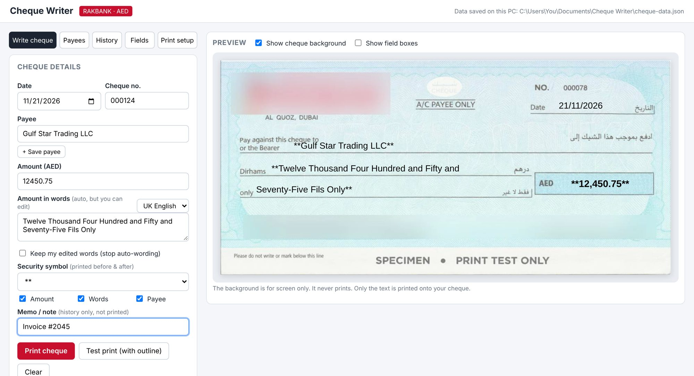

# Cheque Writer

**Cheque printing software for RAKBANK cheques, made for businesses in the UAE.**

🌐 **Website:** https://apsaraaruna.github.io/cheque-writer/
⬇️ **Download:** [Latest installer (.exe)](https://github.com/apsaraaruna/apsaraaruna.github.io/releases/download/cheque-writer-v1.0.6/Cheque-Writer-Setup.exe)

## Features
- Automatic amount in words (UK or US English, with fils)
- Saved payees
- Security symbols around amount, words and payee (`**12,450.75**`)
- Exact print preview: what you see is what prints
- Fields page: drag or nudge every field in mm
- Alignment ruler for quick printer calibration
- Cheque history with CSV export, auto-incrementing cheque numbers
- Works offline, and all data is saved on your PC (`Documents\Cheque Writer`)

## Install
1. Download `Cheque-Writer-Setup.exe` from [Releases](https://github.com/apsaraaruna/apsaraaruna.github.io/releases).
2. Run it. If Windows shows "Windows protected your PC", click **More info → Run anyway** (the installer isn't code-signed yet).
3. In the Windows print dialog keep **Scale 100%** and **Margins: None**.

Requires Windows 10/11, 64-bit.

## About
Built by **Apsara**, a web developer and SEO specialist in Dubai.
[apsaraaruna.dev](https://apsaraaruna.dev)

**Do you need a customised one for your business?** Another bank's layout, several accounts,
approvals or accounting export: [contact me](https://apsaraaruna.dev).

---
Cheque Writer is free to use. The source code is not published in this repository.
Independent software, not affiliated with or endorsed by RAKBANK.
